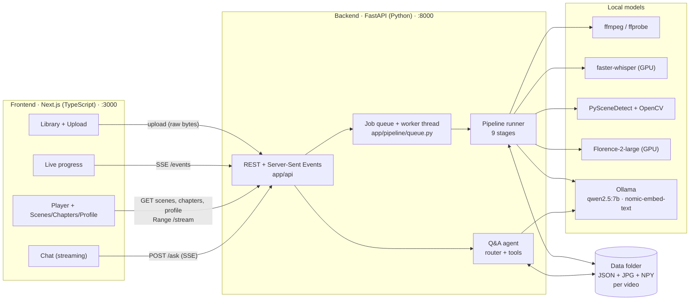
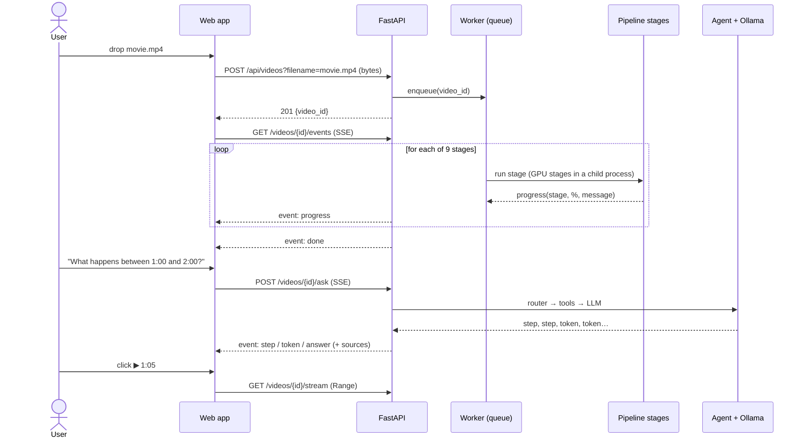
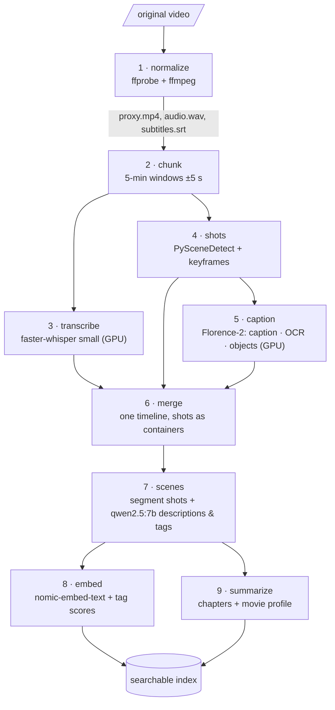
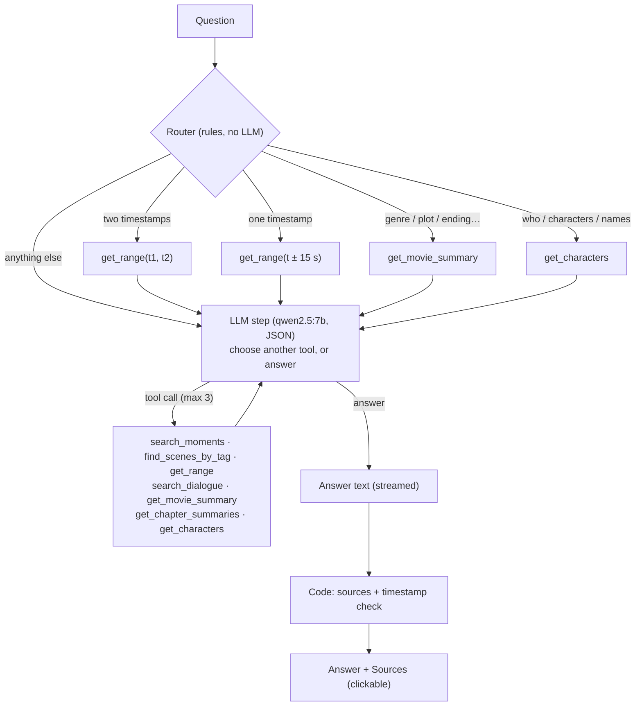

# CineQuery

**Upload a movie or video, let it be processed locally, then ask anything about it.**

> "Show me the romance scenes" · "What happens between 1:42:50 and 1:50:00?" · "What genre is this?" ·
> "Who says *Lisan al-Gaib* and when?" · "How does it end?"

Every answer cites timestamps from the video. In the web app those timestamps are clickable chips that jump
the video player to that moment.

CineQuery is **100% free and local**: open-source models running on your own GPU (tested on an RTX 3050 Laptop
with 4 GB VRAM). No paid APIs, and nothing leaves your machine.

---

## Contents

1. [How it works (big picture)](#how-it-works-big-picture)
2. [Architecture](#architecture)
3. [The processing pipeline (9 stages)](#the-processing-pipeline-9-stages)
4. [Answering questions (the agent)](#answering-questions-the-agent)
5. [Tech stack](#tech-stack)
6. [Project structure](#project-structure)
7. [Setup (Windows + NVIDIA GPU)](#setup-windows--nvidia-gpu)
8. [Running](#running)
9. [Command-line interface](#command-line-interface)
10. [HTTP API](#http-api)
11. [Data layout on disk](#data-layout-on-disk)
12. [Configuration](#configuration)
13. [Performance](#performance)
14. [Design decisions](#design-decisions)
15. [Troubleshooting](#troubleshooting)
16. [Limitations and roadmap](#limitations-and-roadmap)

---

## How it works (big picture)

The design separates **indexing**, which is done once per video, from **answering**, which happens per question.

1. **Indexing is question-agnostic.** The backend watches the whole video once and writes down everything
   it can observe, all on one movie clock in milliseconds:
   - what is **said** (speech recognition)
   - what is **shown as text**: burned-in subtitles, signs, title cards
   - what is **seen** (frame captions and objects)
   - where the **scenes** are, and what happens in each
   - **chapter summaries** and a **movie profile**: genre, plot, characters, ending
   - a **search index** for finding moments by meaning
2. **Answering is retrieval plus reasoning.** A local LLM agent picks tools such as "search moments",
   "scenes with tag X", "everything between t1 and t2", "quote search" and "movie summary". It reads what
   they return and writes a grounded answer with timestamps. Code then attaches the exact source moments.

Because the index records everything rather than answers to fixed questions, users can ask anything,
not just a menu of question types.

---

## Architecture



**Layers and dependency rule.** `api → query / pipeline → adapters`. Adapters are the only modules that
talk to external tools or models (ffmpeg, Whisper, Florence, Ollama, disk), so any of them can be swapped
without touching the stages. Stateless code is plain functions. Classes are used only where something holds
a loaded model or a connection (`WhisperASR`, `FlorenceVision`, `OllamaLLM`, `OllamaEmbedder`).

### End-to-end flow



---

## The processing pipeline (9 stages)

Each stage is a Python module with `NAME`, `is_done(video_id)` and `run(video_id, force, progress)`.
Every stage reads its inputs from disk, writes its outputs to disk, and records `running / done / failed`
(with timing) in `metadata.json`. This gives the pipeline these properties:

- **Resumable.** A crash or restart continues from the last finished stage. Heavy stages also resume per
  chunk, per frame or per scene.
- **Self-invalidating.** A stage re-runs automatically when its inputs change, such as an upstream stage
  re-running, a model switch or a prompt-version bump.
- **Safe.** Every file is written to a temp name and then renamed, so a half-written file never looks finished.



| # | Stage | Input → Output | What it does |
|---|---|---|---|
| 1 | **normalize** | original → `proxy.mp4` (480p, no audio), `audio.wav` (16 kHz mono), `subtitles.srt` (if embedded text subs) | Reads media info and creates standard working files. |
| 2 | **chunk** | duration → `chunks.json` | Splits the timeline into 5-minute windows with 5 s overlap (no files are cut). Overlap duplicates are later removed by the *midpoint-in-core* rule. |
| 3 | **transcribe** | `audio.wav` → `transcripts/cNNN.json` | faster-whisper with voice-activity detection and word timestamps, a hallucination filter, and **a language check on every line**, so fictional or foreign speech is marked rather than trusted. |
| 4 | **shots** | `proxy.mp4` → `shots/cNNN.json`, `frames/*.jpg` | Detects camera cuts (ContentDetector, threshold 20) and saves 1–6 keyframes per shot. |
| 5 | **caption** | keyframes → `captions/cNNN.json` | Florence-2-large writes a detailed caption, reads **on-screen text** (burned-in subtitles carry the meaning of foreign dialogue) and lists objects. Batches 4 frames per GPU call at about 1.8 s/frame. |
| 6 | **merge** | 3 + 4 + 5 → `timeline.json` | Joins shots split at chunk edges, flags unreliable dialogue (`other_language` / `low_confidence`), collapses repeated OCR into single subtitle entries, strips caption boilerplate, flags title cards and credits, and attaches everything to shots. |
| 7 | **scenes** | `timeline.json` → `scenes.json` | Groups shots into scenes using colour-histogram distance, silence, dialogue continuity and title-card cuts (15 s–3 min each). The LLM then writes a title, description, characters, location, mood and events, plus **tags that each need a quoted piece of evidence**. |
| 8 | **embed** | scenes + timeline → `embeddings/index.json` + `vectors.npy` | Embeds scenes, reliable dialogue and on-screen text for search by meaning. **Tag scores** combine the LLM's confidence (60%) with how typical the scene is for that tag *within this movie* (40%). |
| 9 | **summarize** | scenes + quotes → `summaries.json` | Writes about 10-minute chapter summaries, then a **movie profile**: video type, genres with evidence, logline, plot, characters and roles, themes, setting, tone and ending. Tag statistics counted by code are included as hard evidence. |

**Tag vocabulary (stage 7):** dialogue, action, fight, chase, battle, romance, comedy, sad, suspense,
horror, violence, celebration, religious_ritual, speech_to_crowd, travel, nature_landscape,
dream_or_vision, death, betrayal, reunion.

---

## Answering questions (the agent)



| Tool | Answers questions like | Backed by |
|---|---|---|
| `search_moments(query)` | "when does someone warn the crowd?" | Meaning search (stage 8) plus a bonus for exact words |
| `find_scenes_by_tag(tag)` | "show all romance / fight scenes" | Stage 7 tags blended with stage 8 tag scores |
| `get_range(start, end)` | "what happens between 1:42:50 and 1:50:00?" | Scenes, dialogue and on-screen text in that window |
| `search_dialogue(query)` | "who says *Lisan al-Gaib*?" | Exact or fuzzy quote matching |
| `get_movie_summary()` | genre, plot, ending, themes | Stage 9 profile |
| `get_chapter_summaries()` | "what happens in the middle?" | Stage 9 chapters |
| `get_characters()` | "who is in it?" | Profile, per-scene characters and name mentions |

**Grounding rules:**

- The LLM may only use tool results, and must put a `[m:ss]` time on every moment it mentions.
- **Sources are built by code, not by the model.** These are the timed results the answer refers to, so
  clickable timestamps exist even when the small model forgets to write them.
- Any time cited in the answer that was not in the tool results is reported as *unverified*.

**Reliability measures for small local models:**

- JSON-schema outputs, with each reply capped at 500 tokens.
- A 4096-token context, which keeps more of the 7B model on the 4 GB GPU.
- Tolerant JSON parsing, and a failed step falls through to a forced final answer.
- Only the `answer` field of the model's JSON is streamed to the browser, character by character.

---

## Tech stack

| Layer | Tool |
|---|---|
| Frontend | Next.js 15, React 19, TypeScript (no UI library, one CSS file) |
| API | FastAPI + Uvicorn, Server-Sent Events |
| Video / audio | ffmpeg, ffprobe |
| Speech-to-text | faster-whisper `small` (CTranslate2, CUDA) |
| Shot detection | PySceneDetect (ContentDetector) + OpenCV |
| Frame understanding | Florence-2-large (transformers ≥ 5, CUDA torch) |
| LLM | Ollama · `qwen2.5:7b` (scenes, summaries, answers); `qwen2.5:3b` optional for speed |
| Embeddings | Ollama · `nomic-embed-text` (768-dim) |
| Storage | Local folder: JSON, JPG and NumPy files per video (Postgres + pgvector planned) |

---

## Project structure

```
CineQuery/
├── backend/
│   ├── cli.py                     command-line entry point (every stage + inspection + ask)
│   ├── requirements.txt
│   └── app/
│       ├── main.py                FastAPI app (CORS, routers, starts the worker)
│       ├── config.py              all settings, overridable with MOVIEQA_* env vars
│       ├── domain/
│       │   └── timecode.py        parse / format movie times
│       ├── adapters/              the only code that talks to tools, models and disk
│       │   ├── local_storage.py   data-folder layout, atomic JSON, metadata.json
│       │   ├── ffmpeg.py          probe, proxy, audio, frames, subtitles
│       │   ├── audio_io.py        read slices of audio.wav
│       │   ├── whisper_asr.py     WhisperASR (faster-whisper, per-line language check)
│       │   ├── scenedetect.py     camera-cut detection
│       │   ├── florence_vision.py FlorenceVision (caption / OCR / objects, batched)
│       │   ├── ollama_vision.py   OllamaVision (alternative captioner) + Ollama errors
│       │   ├── ollama_llm.py      OllamaLLM (JSON outputs, streaming)
│       │   └── embeddings.py      OllamaEmbedder (nomic-embed-text)
│       ├── pipeline/
│       │   ├── base.py            stage contract, track_stage, require_stage_done
│       │   ├── runner.py          PIPELINE order, run_pipeline, GPU stages in child processes
│       │   ├── queue.py           background worker, job status, live progress
│       │   └── stages/            s01_normalize … s09_summarize
│       ├── query/
│       │   ├── router.py          rule-based pre-routing
│       │   ├── agent.py           tool loop, answer streaming, sources, timestamp check
│       │   └── tools/             search, tags, range, transcript, summary, characters
│       └── api/
│           ├── routes/            uploads, videos, progress (SSE), chat (SSE)
│           ├── schemas/           Pydantic models (OpenAPI at /docs)
│           ├── deps.py, sse.py
├── frontend/
│   ├── app/                       page.tsx (library), videos/[id]/page.tsx (watch), layout, globals.css
│   ├── components/                Uploader, ProcessingView, Chat, InfoTabs, TimedText, TimeChip, ProgressBar
│   └── lib/                       api.ts (typed client + SSE), time.ts
└── eval/                          (planned) question set + evaluation script
```

---

## Setup (Windows + NVIDIA GPU)

**Requirements:** Windows 10/11, an NVIDIA GPU with at least 4 GB of VRAM, Python 3.11, Node.js 20+,
ffmpeg, Ollama and about 15 GB of disk space for models.

```powershell
# 1. Tools
winget install Gyan.FFmpeg            # then make sure ffmpeg's bin folder is on PATH: ffmpeg -version
winget install Ollama.Ollama
winget install OpenJS.NodeJS.LTS

# 2. Local models (Ollama)
ollama pull qwen2.5:7b
ollama pull nomic-embed-text

# 3. Backend environment
cd backend
py -3.11 -m venv .venv
.venv\Scripts\Activate.ps1            # if blocked: Set-ExecutionPolicy -Scope CurrentUser RemoteSigned
pip install torch --index-url https://download.pytorch.org/whl/cu128   # CUDA build FIRST
pip install -r requirements.txt
pip install nvidia-cublas-cu12 "nvidia-cudnn-cu12==9.*"              # GPU libraries for faster-whisper

# 4. Keep processed data out of OneDrive / the repo (recommended)
setx MOVIEQA_DATA_DIR C:\movieqa-data  # open a new terminal afterwards

# 5. Frontend
cd ..\frontend
npm install
```

Whisper and Florence-2 download their weights from Hugging Face on first use: about 0.5 GB and 1.5 GB.

---

## Running

Open two terminals and keep the Ollama app running.

```powershell
# Terminal 1 — backend API (http://localhost:8000, docs at /docs)
cd backend; .venv\Scripts\Activate.ps1
uvicorn app.main:app --port 8000

# Terminal 2 — web app (http://localhost:3000)
cd frontend
npm run dev
```

Open **http://localhost:3000**, then:

1. Drop a video. The live progress page shows each stage.
2. When it's ready, ask questions in the chat and click any ▶ time chip to jump the player.

> Don't start uvicorn with `--reload` while a video is processing. A restart stops the job. It resumes on
> the next start, and finished stages are kept.

---

## Command-line interface

Run from `backend/` with the venv active. This is useful for development and for running single stages.

```powershell
python cli.py ingest "D:\Movies\film.mp4"        # import + run all 9 stages
python cli.py list                                # all videos + stage status
python cli.py info <id>                           # metadata.json (timings, stats)

# run / re-run one stage:  normalize | chunk | transcribe | shots | caption | merge | scenes | embed | summarize
python cli.py scenes <id> --force

# inspect results
python cli.py transcript <id>
python cli.py shot-list <id>
python cli.py captions <id> [--full]
python cli.py timeline <id> [--from 1:40 --to 2:00] [--full]
python cli.py scene-list <id>
python cli.py scene <id> 3
python cli.py chapters <id>
python cli.py profile <id>

# search + ask
python cli.py search <id> "someone warns the crowd" [--kind scene|dialogue|text] [--top 10]
python cli.py tag <id> religious_ritual [--min 0.5]
python cli.py ask <id> "What happens between 1:00 and 2:00?" [--show-tools]
```

---

## HTTP API

Interactive documentation is at **http://localhost:8000/docs**. All paths start with `/api`.

| Method & path | Purpose |
|---|---|
| `GET /health` | Health check |
| `POST /videos?filename=movie.mp4` | Upload (raw file bytes as body, streamed to disk, max 20 GB) → `{video_id}` |
| `POST /videos/import` `{"path": "D:\\Movies\\x.mkv"}` | Register a file already on the server machine (hard link, instant) |
| `GET /videos` | List videos with status and progress |
| `GET /videos/{id}` | Details: progress, ready flag, media info, stage summaries |
| `GET /videos/{id}/progress` | Progress snapshot |
| `GET /videos/{id}/events` | **SSE** live progress: `progress` … then `done` or `failed` |
| `POST /videos/{id}/process` | (Re)start processing; finished stages are skipped |
| `GET /videos/{id}/scenes` · `/chapters` · `/profile` · `/transcript` | Indexed data |
| `GET /videos/{id}/stream` | Video file with HTTP Range support (seeking) |
| `POST /videos/{id}/ask` `{"question": "…"}` | **SSE** answer stream (events below) |
| `POST /videos/{id}/ask/sync` | Same, as one JSON response |

`/ask` sends these events:

| Event | Payload |
|---|---|
| `status` | `{message}`: waiting for the GPU, or thinking |
| `step` | `{action, args, source, seconds}`, once per tool call |
| `token` | `{text}`: the next piece of the answer |
| `reset` | `{}`: discard the streamed text so far (a retry follows) |
| `answer` | `{answer, sources[{label,start_ms,end_ms}], unverified_times, model, seconds, tool_calls}` |
| `error` | `{message}` |

---

## Data layout on disk

```
<MOVIEQA_DATA_DIR>/videos/<video_id>/
├── original.<ext>      untouched input (hard link or copy)
├── proxy.mp4           480p, video only                     (1 normalize)
├── audio.wav           16 kHz mono                          (1)
├── subtitles.srt       only if the file had text subtitles  (1)
├── chunks.json         5-min windows                        (2 chunk)
├── transcripts/cNNN.json   segments + words + language check  (3 transcribe)
├── shots/cNNN.json     shots + keyframe times               (4 shots)
├── frames/000104250.jpg    keyframes, named by movie ms      (4)
├── captions/cNNN.json  caption, on-screen text, objects     (5 caption)
├── timeline.json       dialogue + text + visuals per shot   (6 merge)
├── scenes.json         scenes with descriptions + tags      (7 scenes)
├── embeddings/         index.json + vectors.npy             (8 embed)
├── summaries.json      chapters + movie profile             (9 summarize)
└── metadata.json       media info, stage status + timings, job status
```

All times are integer milliseconds on the movie clock. A detailed field-by-field reference for every file
is kept in the project's architecture notes.

---

## Configuration

Every setting lives in `backend/app/config.py` and can be overridden with an environment variable.
The most useful ones:

| Variable | Default | Meaning |
|---|---|---|
| `MOVIEQA_DATA_DIR` | `./data` | Where processed videos live |
| `MOVIEQA_OLLAMA_URL` | `http://localhost:11434` | Ollama server |
| `MOVIEQA_SCENE_LLM` | `qwen2.5:7b` | Scene descriptions (also the default for summaries and answers) |
| `MOVIEQA_SUMMARY_LLM` | = scene model | Chapters and profile |
| `MOVIEQA_ASK_LLM` | = scene model | Question answering (`qwen2.5:3b` is faster but less accurate) |
| `MOVIEQA_EMBED_MODEL` | `nomic-embed-text` | Embeddings |
| `MOVIEQA_WHISPER_MODEL` | `small` | `tiny` / `base` / `small` / `medium` / `large-v3` |
| `MOVIEQA_WHISPER_LANGUAGE` | auto | Force a language, e.g. `en` |
| `MOVIEQA_CAPTION_ENGINE` | `florence` | `florence` (fast, 4 GB) or `ollama` (Qwen2.5-VL, needs ≥ 8 GB) |
| `MOVIEQA_FLORENCE_MODEL` | `florence-community/Florence-2-large` | `…-base` is faster |
| `MOVIEQA_CAPTION_BATCH` | `4` | Frames per GPU call |
| `MOVIEQA_SHOT_THRESHOLD` | `20` | Lower = more cuts |
| `MOVIEQA_SCENE_CUT` | `0.5` | Higher = fewer, longer scenes |
| `MOVIEQA_SCENE_MIN_MS` / `_MAX_MS` | `15000` / `180000` | Scene length limits |
| `MOVIEQA_CHAPTER_MS` | `600000` | Chapter length (10 min) |
| `MOVIEQA_ASK_MAX_STEPS` | `3` | Tool calls before the agent must answer |
| `MOVIEQA_CORS_ORIGINS` | `http://localhost:3000,…` | Allowed frontend origins |
| `MOVIEQA_MAX_UPLOAD_GB` | `20` | Upload size limit |
| `NEXT_PUBLIC_API_URL` (frontend `.env.local`) | `http://localhost:8000` | Where the web app finds the API |

---

## Performance

Measured on an RTX 3050 Laptop (4 GB) with a 3:23 trailer, and extrapolated to a 2-hour movie:

| Stage | 3:23 clip | ~2-hour movie (estimate) |
|---|---|---|
| normalize | 11 s | ~10 min |
| transcribe (GPU) | 11 s | ~10 min |
| shots | 10 s | ~6 min |
| caption (Florence-2, 1.8 s/frame) | 2.4 min (80 frames) | ~1.5 h (~3,000 frames) |
| scenes (qwen2.5:7b, ~75 s/scene) | 11 min (9 scenes) | **3–6 h**, the main bottleneck |
| embed | ~1.5 min | a few minutes |
| summarize (~112 s per call) | ~4 min | ~25 min |
| **ask** (per question) | 20–75 s | similar |

Processing is a one-time background job per video, and later questions reuse the index.

---

## Design decisions

- **Index once, answer anything.** Stages record observations, not answers to fixed questions; the agent
  decides at question time which evidence to fetch.
- **Speech, on-screen text and visuals are weighted differently.** Captions from a small vision model
  hallucinate (microphones, stages, concerts), so they are treated as weak hints. Reliable dialogue and
  subtitles are strong evidence. Speech in another language is replaced by `[speech in another language]`
  rather than gibberish.
- **Evidence-required tags.** A small LLM asked to score 20 tags gives everything high scores. Requiring a
  quoted reason per tag, plus strict definitions, fixed this; comparing scenes within the same movie then
  ranks the most typical ones first.
- **Small-model-friendly prompting.** Structured JSON outputs, capped reply length, short context, and code
  rather than the model for anything that must be exact: sources, timestamps, statistics.
- **One GPU, one model at a time.** A single worker processes videos one by one. Whisper and Florence run in
  child processes, which prevents a cuDNN DLL clash between faster-whisper and torch and fully frees
  memory between stages.
- **Files before a database.** JSON per stage keeps each step inspectable and resumable. Postgres + pgvector
  is planned for multi-user scale.
- **Plain functions by default.** Classes only for adapters that hold a loaded model or connection.

---

## Troubleshooting

| Problem | Fix |
|---|---|
| `cublas64_12.dll not found` (transcribe) | `pip install nvidia-cublas-cu12 "nvidia-cudnn-cu12==9.*"` in the venv |
| `WinError 127 … cudnn_cnn64_9.dll` | Make sure `app/pipeline/runner.py` has `ISOLATED_STAGES`, restart the API, click Retry |
| "Application Control policy has blocked this file" | Windows Smart App Control blocks unsigned DLLs (ctranslate2) |
| Florence import error | Install the CUDA torch build first, then `transformers>=5` |
| `Cannot reach Ollama` | Start the Ollama app; check `ollama list` shows `qwen2.5:7b` and `nomic-embed-text` |
| Answers time out or hang | Restart Ollama; try `$env:MOVIEQA_ASK_LLM = "qwen2.5:3b"` |
| Code changes "revert" | VS Code hot exit restores stale tabs: set `"files.hotExit": "off"` and close old tabs |
| Video won't play in the browser | Use MP4 (H.264). MKV and AVI may not play natively yet |
| PowerShell won't activate the venv | `Set-ExecutionPolicy -Scope CurrentUser RemoteSigned` |

---

## Limitations and roadmap

**Current limitations:**

- Tested end to end on a short trailer. A full-length movie test is the next milestone.
- Scene descriptions are slow on a 4 GB GPU (about 75 s per scene with 7B).
- Character names come from speech recognition and can be misspelled. Titles and ASR noise can show up as names.
- Chat has no memory of earlier questions yet.
- The player streams the original file, so MKV and AVI may not play in browsers.
- Single local user: no authentication, and job state lives in one server process.

**Roadmap:**

1. Full-movie test and tuning: speed (3B for scenes or batching), character-name cleanup.
2. Chat follow-ups ("and what happens after that?").
3. A browser-playable 720p MP4 made during normalize.
4. An evaluation set (`eval/`): about 20 questions with expected answers, run after every change.
5. A `look_again` tool: re-run the vision model on specific frames for detailed visual questions.
6. Face clustering for characters, and audio-event detection (music, explosions, laughter).
7. Postgres + pgvector, a proper job queue, and multi-user support.
